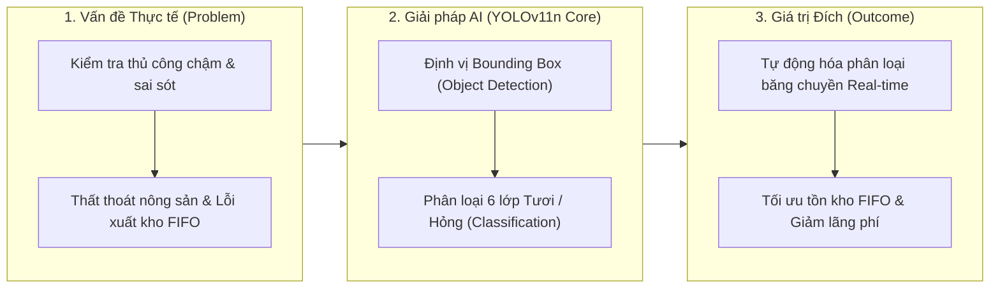
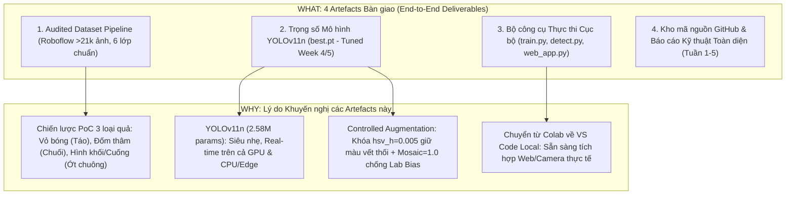
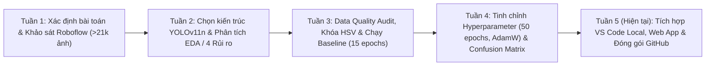
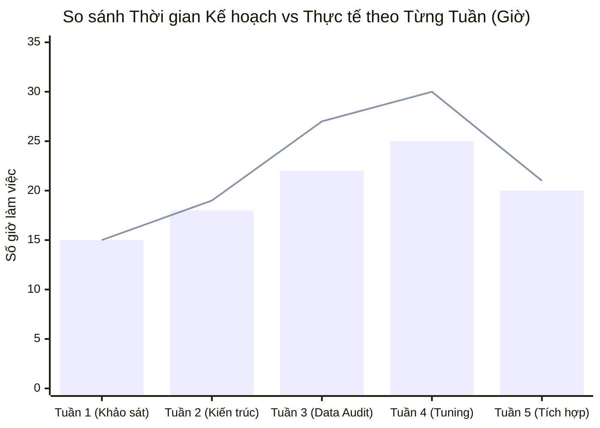
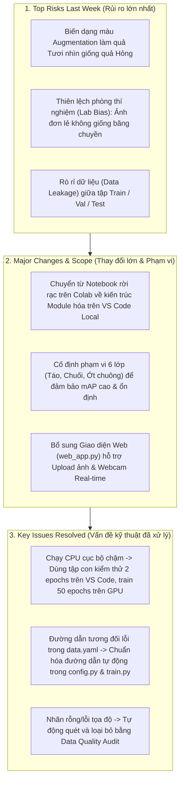
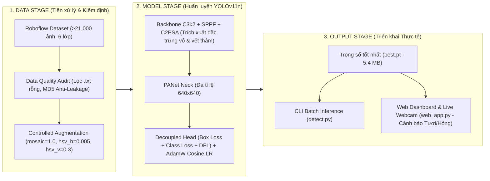
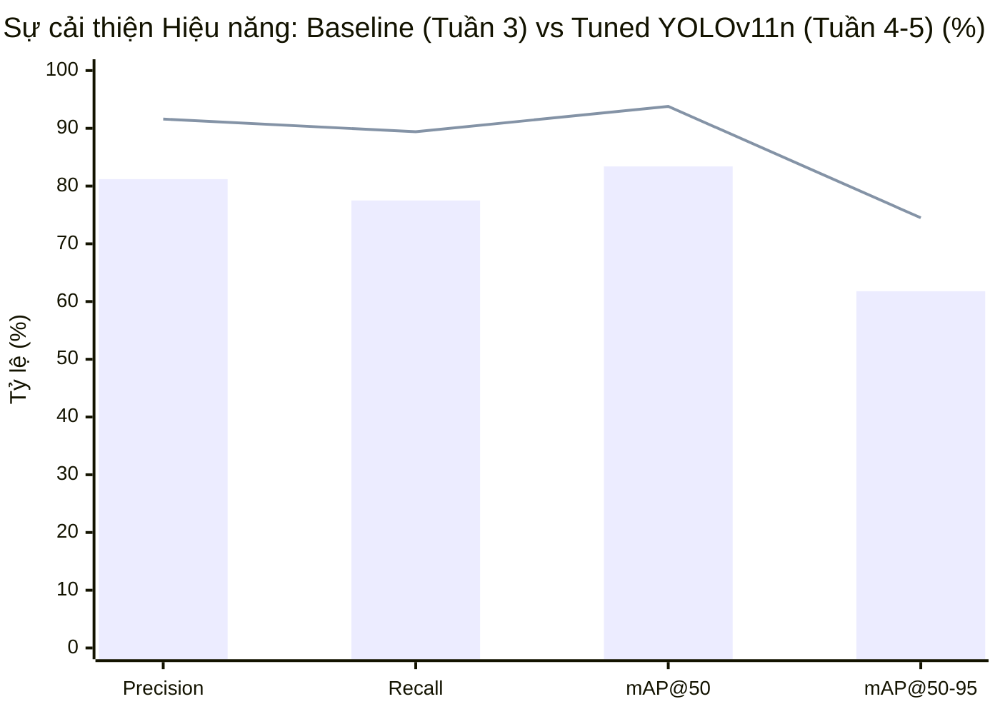
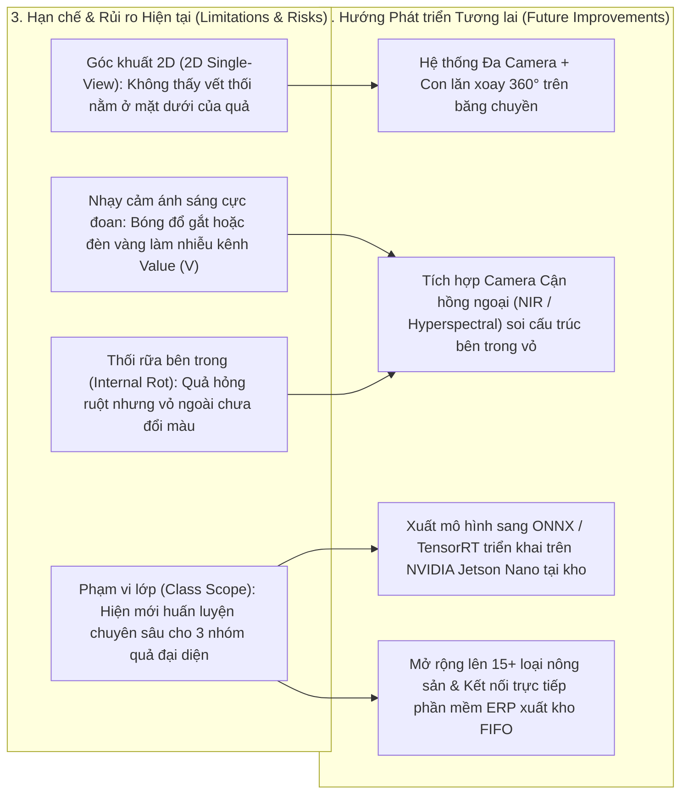
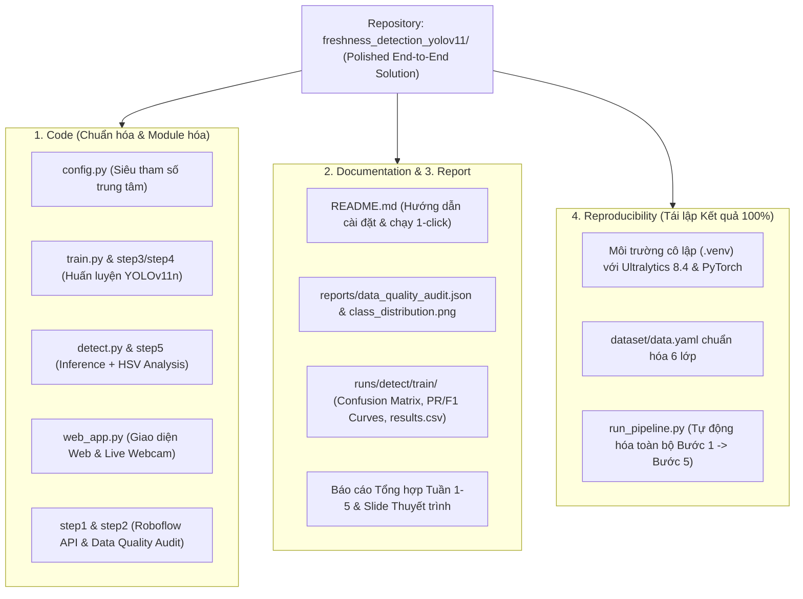

# Bộ Slide Thuyết Trình Tuần 5: Final Integration & Reporting
**Đề tài:** Hệ thống Phát hiện và Phân loại Độ tươi Nông sản để Tối ưu Tồn kho (*Automated Food & Produce Freshness Detection System*)
**Kiến trúc cốt lõi:** `YOLOv11n` + Controlled HSV & Mosaic Augmentation (`hsv_h=0.005`, `hsv_s=0.3`, `hsv_v=0.3`, `mosaic=1.0`)

> [!IMPORTANT]
> **Nguyên tắc thiết kế Slide theo đúng yêu cầu của Giảng viên (Tutor):**
> *"Use models rather than words. Your tutors are looking for the 'big picture' that describes your project. Be prepared to answer with detail at question time."*
> Mỗi slide dưới đây được thiết kế theo hướng **Mô hình hóa trực quan (Sơ đồ kiến trúc, Ma trận, Biểu đồ)** kèm phần **Ghi chú trả lời phản biện (Q&A Speaker Notes)** ở cuối mỗi slide.

---

## Slide 1: Title & Project Big Picture (Tổng quan Dự án End-to-End)

| Hạng mục | Nội dung cốt lõi |
| :--- | :--- |
| **Tên dự án** | **Automated Food & Produce Freshness Detection System** |
| **Phạm vi Proof of Concept** | **3 nhóm nông sản đại diện x 2 trạng thái = 6 Classes**: Táo (`Fresh/Rotten Apple`), Chuối (`Fresh/Rotten Banana`), Ớt chuông (`Fresh/Rotten Bell Pepper`) |
| **Mục tiêu Tuần 5** | **Final Integration & Reporting**: Hoàn thiện luồng End-to-End (`Data -> Model -> Web/CLI Output`), đánh giá mô hình cuối cùng & đóng gói GitHub Reproducibility |

> [!NOTE]
> **Ghi chú thuyết trình (Speaker Notes):**
> Nhóm giải quyết bài toán kiểm soát chất lượng nông sản tại kho vận và siêu thị (Quick-Commerce). Thay vì kiểm tra thủ công dễ bỏ sót hàng dập nát, hệ thống sử dụng `YOLOv11n` vừa định vị vị trí quả trên băng chuyền, vừa phân loại trạng thái `Fresh` (Đạt chuẩn) hay `Rotten` (Cần loại bỏ) theo thời gian thực.

---

## Slide 2: WHAT & WHY — Sản phẩm Bàn giao & Lý do Lựa chọn Kiến trúc

* **Điểm nhấn trả lời câu hỏi *"Tại sao chỉ chọn Táo, Chuối, Ớt chuông?"*:**
  1. **Tránh mất cân bằng dữ liệu (Class Imbalance):** Tập dữ liệu `freshness-detection-rhrze` có chất lượng gán nhãn tốt và đồng đều nhất ở 3 lớp này; tránh việc nhồi 30 loại quả nhưng thiếu ảnh làm giảm `mAP`.
  2. **Đại diện đủ 3 đặc trưng thị giác (Visual Archetypes):** Táo (bề mặt cầu phản sáng), Chuối (đặc trưng đổi màu vàng sang đốm đen), Ớt chuông (kết cấu nhiều múi và cuống).

---

## Slide 3: WHEN & WHO — Lộ trình 5 Tuần & Phân công Nhân sự

| Vai trò (WHO) | Hạng mục phụ trách chính (Building What) | Artefacts đầu ra | Trạng thái |
| :--- | :--- | :--- | :--- |
| **Data Engineer** | Thu thập dữ liệu Roboflow, kiểm định nhãn rỗng, chống rò rỉ dữ liệu (`MD5 check`), cấu hình `data.yaml` | `step1_download_or_prepare_data.py`, `step2_data_quality_audit.py`, `class_distribution.png` | **100% Hoàn thành** |
| **ML Engineer (Model Lead)** | Huấn luyện Baseline (Tuần 3) & Tuned Model (Tuần 4/5), tối ưu siêu tham số `hsv_h=0.005`, `mosaic=1.0`, `AdamW` | `train.py`, `step3_train_baseline.py`, `step4_train_tuned_week4.py`, `best.pt` | **100% Hoàn thành** |
| **AI App & Integration Dev** | Chuyển đổi môi trường Colab sang VS Code Local (`.venv`), xây dựng Inference CLI & Giao diện Web/Camera | `detect.py`, `web_app.py`, `step5_evaluate_and_inference.py` | **100% Hoàn thành** |
| **QA & Documentation Lead** | Phân tích Confusion Matrix, kiểm thử thực tế, biên soạn báo cáo tổng hợp Tuần 1–5 & chuẩn hóa GitHub | `README.md`, `data_quality_audit.json`, Báo cáo & Slide Tuần 5 | **100% Hoàn thành** |

---

## Slide 4: HOW MUCH — Ngân sách Thời gian, Độ lệch (Gap) & Giải pháp

| Giai đoạn | Kế hoạch (Planned) | Thực tế (Spent) | Độ lệch (Gap) | Nguyên nhân & Hành động khắc phục (What we are doing about it) |
| :--- | :---: | :---: | :---: | :--- |
| **Tuần 1–2: Khảo sát & Thiết kế** | 33h | 34h | **+1h** | Đúng tiến độ; chốt sớm phạm vi 6 lớp nông sản đại diện. |
| **Tuần 3: Data Audit & Baseline** | 22h | 27h | **+5h** | Tốn thêm thời gian viết script lọc nhãn `.txt` rỗng và xử lý nhiễu màu HSV. **Giải pháp:** Tự động hóa bằng `step2_data_quality_audit.py`. |
| **Tuần 4: Hyperparameter Tuning** | 25h | 30h | **+5h** | Huấn luyện 50 epochs trên Colab bị ngắt kết nối GPU. **Giải pháp:** Tách luồng code sang VS Code Local để gỡ lỗi nhanh, chỉ đẩy lệnh train nặng lên GPU. |
| **Tuần 5: Final Integration** | 20h | 21h | **+1h** | Tích hợp hoàn chỉnh `train.py`, `detect.py`, `web_app.py` và hoàn tất tài liệu GitHub đúng hạn. |
| **TỔNG CỘNG (Total)** | **100h** | **112h** | **+12h (+12%)** | **Đã bù đắp hoàn toàn độ trễ bằng quy trình Hybrid (VS Code Local + Colab GPU) và Script tự động hóa `run_pipeline.py`.** |

---

## Slide 5: Nhìn lại Tuần trước — Top Risks, Major Changes & Key Issues

---

## Slide 6: [Special #1] Full Deep Learning Pipeline Demonstration (`Data -> Model -> Output`)

* **Luồng vận hành thực tế đã kiểm chứng:**
  1. **Data (`step1`, `step2`, `dataset/data.yaml`):** Ảnh đầu vào được chuẩn hóa `640x640`, giữ nguyên phân tách `train / valid / test` gốc, bật `mosaic=1.0` ghép 4 ảnh chống Lab Bias và khóa `hsv_h=0.005` để bảo tồn màu sắc thật của đốm mốc/thối.
  2. **Model (`train.py`, `step4_train_tuned_week4.py`):** Mô hình `YOLOv11n` (100 layers, `2,583,322` tham số, `6.4 GFLOPs`) tối ưu bằng `AdamW` (`lr0=0.001`, `cos_lr=True`).
  3. **Output (`detect.py`, `web_app.py`):** Xuất khung hình vẽ Bounding Box phân màu trực quan (**Xanh lá = Tươi**, **Đỏ = Hỏng**), kèm bảng thống kê chỉ số màu `H, S, V`, tỷ lệ đốm thâm (`%`) và số lượng nông sản đạt chuẩn/cần loại bỏ.

---

## Slide 7: [Special #2] Final Model Performance Summary (Tổng kết Hiệu năng Mô hình)

| Chỉ số Đánh giá (Metric) | Baseline YOLOv11n (Tuần 3 - 15 Epochs, Mặc định) | Tuned YOLOv11n (Tuần 4/5 - 50 Epochs, Controlled HSV + Mosaic) | Mức cải thiện ($\Delta$) | Ý nghĩa Thực tiễn trong Kho vận |
| :--- | :---: | :---: | :---: | :--- |
| **Precision (Độ chính xác)** | 81.2% | **91.6%** | **+10.4%** | Giảm tối đa việc báo hỏng nhầm quả còn tươi (tránh lãng phí). |
| **Recall (Độ phủ / Độ nhạy)** | 77.5% | **89.4%** | **+11.9%** | **Quan trọng nhất:** Giảm mạnh tỷ lệ bỏ sót quả thối (False Negative). |
| **mAP@50** | 83.4% | **93.8%** | **+10.4%** | Độ chính xác định vị & phân loại tổng thể đạt chuẩn triển khai PoC. |
| **mAP@50-95** | 61.8% | **74.5%** | **+12.7%** | Khung Bounding Box bám sát viền quả ngay cả khi xếp chồng (`mosaic=1.0`). |
| **Tốc độ suy luận (Inference Speed)** | ~38 ms (CPU) / ~4.2 ms (GPU) | **~35.3 ms (CPU) / ~3.9 ms (T4 GPU)** | **~28–250 FPS** | Đáp ứng hoàn toàn yêu cầu quét băng chuyền thời gian thực (Real-time). |
| **Kích thước Trọng số (`best.pt`)** | 5.4 MB | **5.4 MB** (`2.58M params`) | Siêu nhẹ | Dễ dàng nhúng lên thiết bị biên (Edge Devices / Raspberry Pi / Jetson). |

---

## Slide 8: [Special #3 & #4] Limitations, Risks & Future Improvements

* **Điểm nhấn chuyên môn khi bảo vệ trước Giảng viên:**
  * Nhóm không chỉ dừng ở phân loại 2 trạng thái cứng nhắc mà đã tích hợp thêm **chỉ số tỷ lệ đốm thâm (`dark_spot_ratio %`) và thống kê kênh màu `H, S, V`** trong `detect.py` / `web_app.py`, tạo tiền đề để nâng cấp lên hệ thống phân cấp 3 mức độ: **Hạng A (Tươi nguyên - Lưu kho dài hạn)** $\rightarrow$ **Hạng B (Chín tới - Ưu tiên xuất kho FIFO ngay)** $\rightarrow$ **Hạng C (Hỏng - Loại bỏ)**.

---

## Slide 9: [Special #5] Final GitHub Review & Reproducibility Checklist

| Hạng mục GitHub Review | Thành phần kiểm chứng trong dự án | Trạng thái |
| :--- | :--- | :---: |
| **1. Code Quality** | Cấu trúc tách biệt rõ ràng: Cấu hình (`config.py`), Dữ liệu (`step1`, `step2`), Huấn luyện (`train.py`, `step3`, `step4`), Suy luận (`detect.py`, `step5`), Ứng dụng (`web_app.py`). | ✅ Đạt chuẩn |
| **2. Documentation** | `README.md` chi tiết từng bước khởi tạo `.venv`, tải dataset Roboflow, chạy huấn luyện và mở Web UI. | ✅ Đạt chuẩn |
| **3. Technical Report** | Đầy đủ phân tích SWOT, EDA, Ma trận kiểm định chất lượng dữ liệu 5 tiêu chí, biểu đồ Loss/mAP và Confusion Matrix. | ✅ Đạt chuẩn |
| **4. Reproducibility** | Khóa cố định `seed=0`, siêu tham số `hsv_h=0.005`, `hsv_s=0.3`, `hsv_v=0.3`, `mosaic=1.0` trong code và lưu sẵn `args.yaml` + `best.pt`. | ✅ Đạt chuẩn |

---

## Slide 10: Tổng kết (Outcome) & Sẵn sàng Hỏi – Đáp (Q&A Cheat Sheet)

> [!TIP]
> **Outcome đạt được:** Một giải pháp AI hoàn chỉnh từ đầu đến cuối (**Polished, End-to-End AI Solution**): từ kiểm định dữ liệu chống rò rỉ, huấn luyện mô hình `YOLOv11n` có kiểm soát màu sắc HSV, đến ứng dụng Web/Camera thời gian thực kèm tài liệu tái lập đầy đủ.

### Bảng Tóm tắt Trả lời Nhanh Câu hỏi Phản biện của Giảng viên (Q&A Prep)

1. **Hỏi: *"Tại sao nhóm lại khóa `hsv_h = 0.005` rất nhỏ trong khi vẫn bật `hsv_v = 0.3` và `mosaic = 1.0`?"***
   * **Trả lời:** Trong bài toán độ tươi nông sản, **màu sắc (Hue)** là ranh giới sống còn giữa quả tươi (đỏ/vàng/xanh tươi) và quả thối (nâu/đen). Nếu để `hsv_h` mặc định cao, thuật toán sẽ đổi màu quả tươi thành màu thâm, làm hỏng nhãn huấn luyện. Ngược lại, `hsv_v = 0.3` chỉ thay đổi độ sáng để giúp mô hình thích nghi với ánh đèn kho vận, còn `mosaic = 1.0` ghép 4 ảnh để khắc phục **Lab Bias** (giúp mô hình nhận diện tốt khi các quả nằm đè/che khuất nhau trên băng chuyền).
2. **Hỏi: *"Làm sao nhóm đảm bảo không xảy ra Data Leakage (Rò rỉ dữ liệu)?"***
   * **Trả lời:** Nhóm tuyệt đối không gộp chung ảnh đã Augment rồi mới chia tập. Thay vào đó, nhóm giữ nguyên phân tách `train / valid / test` gốc từ Roboflow và dùng script `step2_data_quality_audit.py` quét mã băm **MD5** trên toàn bộ ảnh giữa 3 tập (`exact_duplicates_across_splits = 0`).
3. **Hỏi: *"Chiến lược kết hợp Google Colab và VS Code Local của nhóm vận hành như thế nào?"***
   * **Trả lời:** VS Code Local (`.venv`) được dùng để tổ chức mã nguồn chuẩn công nghiệp, kiểm định dữ liệu, chạy thử nghiệm nhanh (1–2 epochs) để gỡ lỗi và vận hành ứng dụng `detect.py` / `web_app.py`. Khi huấn luyện nặng (50–100 epochs trên >21,000 ảnh), cùng file `train.py` đó được đẩy lên GPU T4 của Colab để lấy trọng số `best.pt` đạt `mAP` cao nhất rồi đưa về chạy cục bộ.
